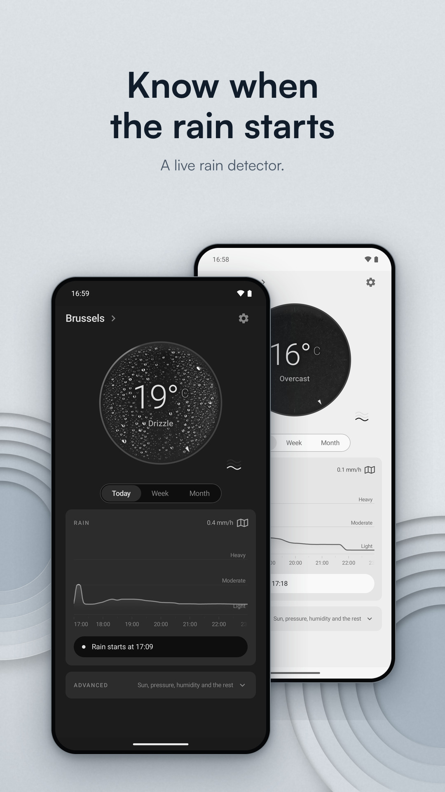
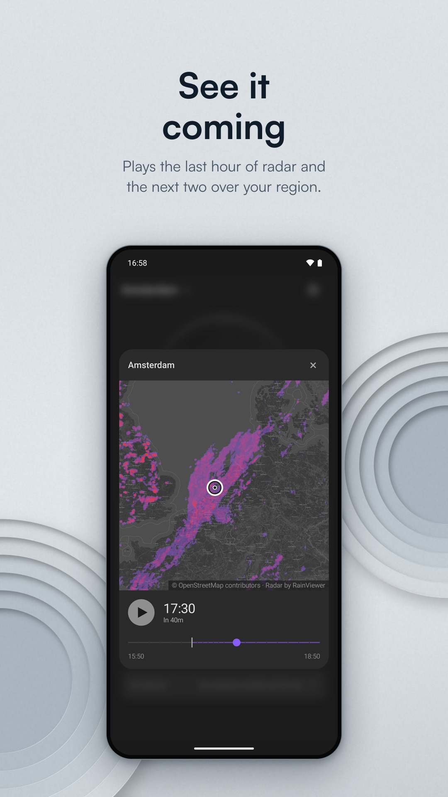
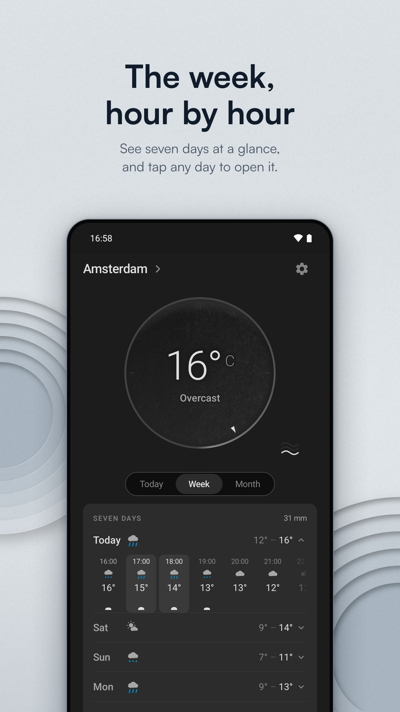
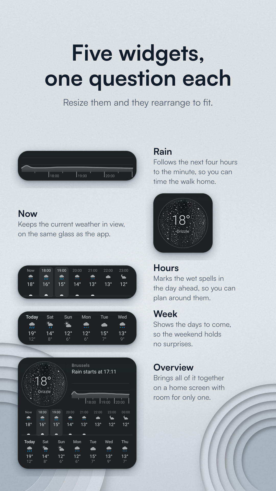
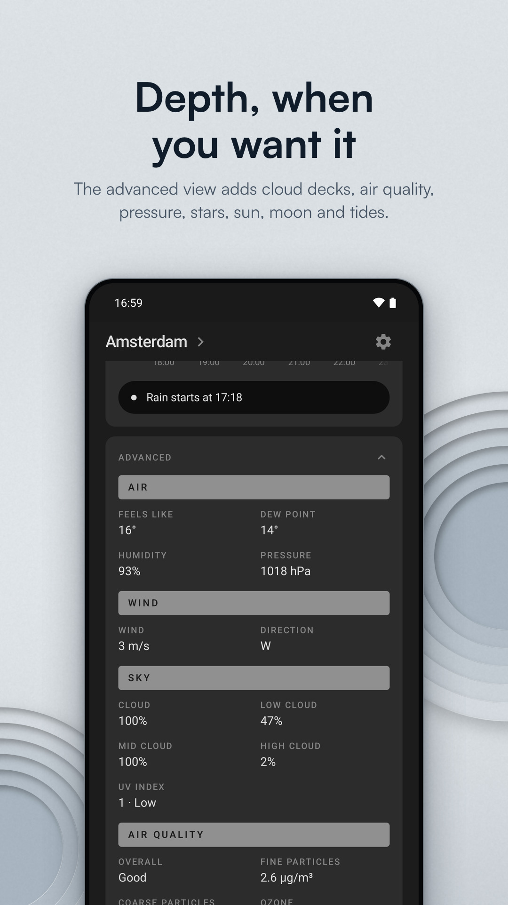
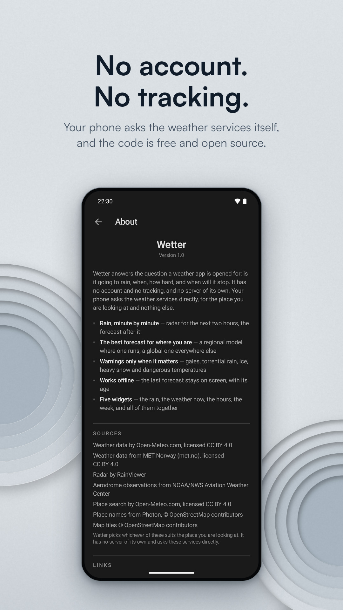

# Wetter

A weather app for Android built around rain: whether it will rain, when, how
heavily, and when it will stop. It has no account, no tracking, no ads and no
server of its own.

<p align="center">
  
  
  
  
  
  
</p>

Version 1.0 · GPL-3.0-or-later · Android 8.0 and later · coming to F-Droid

---

## What it does

- It shows rain to the minute, from radar for the next two hours and from the
  forecast models after that, on one timeline.
- A rain map plays the last hour of radar and the next two as a loop.
- Today, the week and the month each have a page, and any day of the week
  opens to its hours.
- Five home-screen widgets show the next four hours of rain, the weather now,
  the coming hours, the week, or all of them together.
- It warns only about gales, torrential rain, heavy snow, ice, thunderstorms and
  dangerous temperatures.
- Without a connection, the last forecast stays on screen with its age.

## Services it uses

The app has no server. The phone asks these services directly, with no account,
identifier or cookie:

| Service | Used for | What is sent |
|---|---|---|
| [Open-Meteo](https://open-meteo.com) | Forecasts, air quality, place search | The place's coordinates; what you type into search |
| [MET Norway](https://api.met.no) | Forecasts (a 2.5 km Nordic model, a global one elsewhere) | The place's coordinates, truncated to four decimals |
| [RainViewer](https://www.rainviewer.com) | Radar | The map tiles around the place |
| [NOAA/NWS Aviation Weather Center](https://aviationweather.gov) | Airport reports, to check past forecasts | A box around the place |
| [Photon](https://photon.komoot.io) | Names for points placed on the map | The point's coordinates |
| [OpenStreetMap](https://www.openstreetmap.org) | Map tiles | The map tiles around the place |

Open-Meteo and MET Norway data are licensed
[CC BY 4.0](https://creativecommons.org/licenses/by/4.0/), MET Norway's under its
[terms of service](https://api.met.no/doc/TermsOfService). Place names and map
tiles are © OpenStreetMap contributors. Every source is credited on the app's
About screen.

## Permissions

| | |
|---|---|
| `INTERNET` | Used to ask the services above about a place. |
| `ACCESS_NETWORK_STATE` | Used to tell "offline" apart from "the service is not answering". |
| `ACCESS_COARSE_LOCATION` | Optional, and used for a single fix when you ask for your current location, never in the background. |
| `POST_NOTIFICATIONS` | Optional, and used for severe-weather warnings, which can be switched off in Settings. |
| `RECEIVE_BOOT_COMPLETED` | Used to restart the background refresh after the phone restarts. |
| `WAKE_LOCK` | Added by WorkManager, which keeps the phone awake while a background refresh runs. |

Refusing an optional permission leaves everything else working.

## Privacy

Wetter collects nothing, and it has no analytics, crash reporter or
advertising identifier. Saved places, settings and cached forecasts stay in the app's
private storage, with cloud backup and device-to-device transfer switched off.
The full policy is in [docs/privacy-policy.md](docs/privacy-policy.md).

## Build and install

Needs JDK 17 and the Android SDK (platform 36). Point Gradle at the SDK with
`ANDROID_HOME`, or a `local.properties` file containing `sdk.dir=/path/to/sdk`.
No keys, accounts or signing material are needed.

```sh
git clone https://github.com/Perszus/wetter.git
cd wetter
./gradlew installDebug       # build and install on a connected phone
```

```sh
./gradlew assembleRelease    # unsigned release APK in app/build/outputs/apk/release/
./gradlew check              # tests, lint and formatting, as CI runs them
```

The release build is reproducible: two builds of the same commit produce a
byte-identical APK ([how to check](docs/RELEASING.md#the-release-build-is-reproducible--check-it)).

## How it is put together

```text
:app  ──▶  :data  ──▶  :domain
```

- **`:domain`** is plain Kotlin, with no Android and no networking. It holds the
  forecasts, provider selection, the rain timeline, radar nowcasting and
  warnings.
- **`:data`** holds the providers, the router that picks one per place and fails
  over to the next, and the offline cache.
- **`:app`** holds the Compose UI, the widgets, notifications and background
  refresh.

Further reading: [providers](docs/providers.md) ·
[design principles](docs/design-principles.md) ·
[visual language](docs/visual-language.md) · [decisions](docs/decisions.md) ·
[releasing](docs/RELEASING.md)

## Contributing

Bug reports and patches are welcome; see [CONTRIBUTING.md](.github/CONTRIBUTING.md).
Dependencies must be free software that F-Droid can build.

## Licence

GNU General Public License v3.0 or later; see [LICENSE](LICENSE). One
additional permission under section 7 allows distribution through app stores
whose terms would otherwise conflict with section 6, and grants nothing else;
see [LICENSE-EXCEPTION.txt](LICENSE-EXCEPTION.txt).

All artwork, including the icon and the pictures on the dial's glass, is part of
Wetter and licensed under the same terms.

Copyright © 2026 Roberts Kains.
